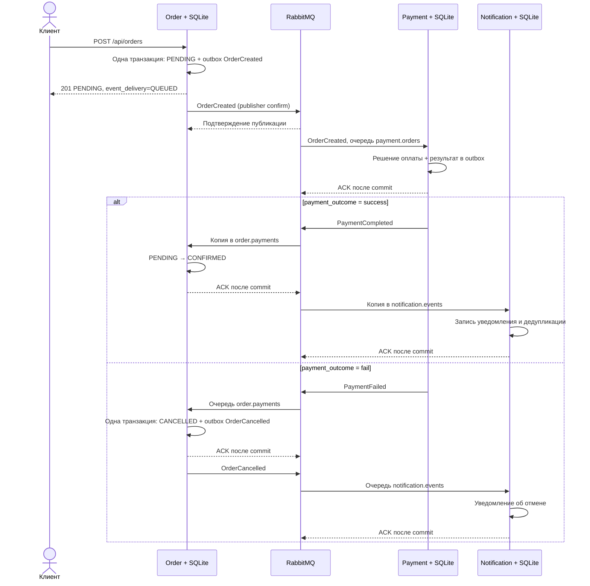

# ЛР №4 — сервис заказов и Saga

Куулар Санчай и Савельев Дмитрий, ТПУ, группа 8И41.

Дмитрий добавил первые публикации OrderCreated, обработчики результата оплаты, отмену заказа с OrderCancelled и заготовку Payment. Его коммиты объединены с сохранением авторства. В ветке Санчая добавлены настоящий локальный RabbitMQ, Notification, SQLite, надёжная отправка событий и проверки обоих сценариев. Исправления DataLoader ЛР №3 сохранены.

## Как работает Saga

Это хореография: отдельного координатора нет, сервисы реагируют на события. Order сохраняет PENDING, Payment имитирует платёж и отправляет результат. При успехе Order меняет статус на CONFIRMED; при ошибке — на CANCELLED и отправляет OrderCancelled. Notification получает свою копию PaymentCompleted либо OrderCancelled и пишет «Отправлено уведомление клиенту» с orderId.

Компенсация здесь — логическая отмена заказа после отказа оплаты. Это новая операция, а не откат общей транзакции между сервисами. Настоящего списания денег, возврата платежа и резервирования книг нет.



## Отправка и повторы

- Три приложения используют разные SQLite-файлы и volumes. Order хранит заказы; inbox хранит обработанные eventId; outbox — события, ожидающие подтверждения RabbitMQ.
- Запись заказа/статуса и outgoing-события выполняется одной транзакцией SQLite. Пока брокер отключён, API возвращает PENDING и QUEUED; событие остаётся в outbox и отправляется после восстановления. Ошибка SQLite не скрывается успешным ответом.
- Обменник `marketplace.events` — durable topic. Сообщения persistent, публикация mandatory с publisher confirms. ACK потребителя отправляется после commit.
- Pika-соединение и channel создаёт и использует только собственный поток worker. HTTP-обработчики работают с SQLite и не обращаются к Pika.
- Если процесс упадёт после публикации, но до отметки sent_at, сообщение может прийти повторно. Inbox и проверка бизнес-эффекта защищают от повторной обработки даже после рестарта. Это at-least-once доставка с идемпотентностью, а не обещание exactly-once транспорта.
- `payment.orders` подписана на OrderCreated; `order.payments` — на PaymentCompleted/PaymentFailed; `notification.events` — на PaymentCompleted/OrderCancelled. Поэтому Order и Notification получают собственные копии PaymentCompleted, а не конкурируют за одну очередь.
- Некорректные сообщения отклоняются в очередь `invalid.events`. Временная ошибка БД закрывает соединение, неподтверждённое сообщение возвращается в очередь.
- Notification только имитирует отправку записью в журнал и SQLite; внешние сообщения пользователям не отправляются. Healthcheck Payment/Notification проверяет их SQLite, а соединение/подписчика нужно смотреть в RabbitMQ UI и логах.

## Фрагменты действующего кода

Order сохраняет заказ и событие одной транзакцией (`order_service/main.py`):

```python
with transaction() as db:
    db.execute("INSERT INTO orders VALUES(?,?,?)", (order_id, json.dumps(new_order), "PENDING"))
    enqueue(db, "OrderCreated", order_id, userId=order.user_id,
        items=[{"productId": item.product_id, "quantity": item.quantity} for item in order.items],
        totalAmount=order.total_amount, paymentOutcome=order.payment_outcome, createdAt=new_order["created_at"])
```

Фактическую публикацию выполняет worker (`messaging.py`):

```python
channel.basic_publish(exchange=EXCHANGE, routing_key=row["event_type"],
    body=row["body"].encode(), mandatory=True,
    properties=pika.BasicProperties(content_type="application/json", delivery_mode=2,
        message_id=row["event_id"], type=row["event_type"], correlation_id=row["order_id"]))
```

Перед этим включён `channel.confirm_delivery()`. Только после подтверждения публикации outbox получает sent_at.

Payment выбирает результат по `paymentOutcome` и записывает его в outbox. В ветке успеха это PaymentCompleted, в ветке ошибки — PaymentFailed. Проверка `effects` по orderId исключает второй платёж даже для повторного события с новым eventId (`payment_service/main.py`).

```python
if outcome == "success":
    event_type = "PaymentCompleted"
    fields.update(status="completed", transactionId="demo-" + order_id)
else:
    event_type = "PaymentFailed"
    fields.update(status="failed", reason="Simulated payment failure")
result = enqueue(db, event_type, order_id, **fields)
db.execute("INSERT INTO effects VALUES(?,?)", (key, json.dumps(result)))
```

Компенсация Order (`order_service/main.py`):

```python
if event["eventType"] == "PaymentCompleted":
    status = "CONFIRMED"
else:
    status = "CANCELLED"
    enqueue(db, "OrderCancelled", order_id, userId=order["user_id"], reason=event.get("reason", "Payment failed"))
db.execute("UPDATE orders SET status=? WHERE id=?", (status, order_id))
```

Обработчик предварительно проверяет, что текущий статус PENDING. После commit общий worker отправляет `basic_ack`.

## Примеры событий

Ниже шаблон OrderCreated; действительные события обоих сценариев сохраняются в локальном `artifacts/lab4/events.json` без секретов.

```json
{
  "eventId": "11111111-1111-4111-8111-111111111111",
  "eventType": "OrderCreated",
  "orderId": "22222222-2222-4222-8222-222222222222",
  "userId": "student@example.com",
  "items": [{"productId": 1, "quantity": 1}],
  "totalAmount": 500,
  "paymentOutcome": "success",
  "createdAt": "2026-10-28T12:00:00+00:00",
  "occurredAt": "2026-10-28T12:00:00+00:00"
}
```

PaymentCompleted содержит eventId/eventType/orderId, userId, amount, transactionId, status=completed и время. PaymentFailed вместо transactionId содержит reason и status=failed. OrderCancelled содержит eventId/eventType/orderId, userId, reason и occurredAt.

## Демонстрация PowerShell

Сначала создайте локальный `.env` по README и запустите Docker Desktop. Из корня проекта:

```powershell
docker compose up --build -d --wait
docker compose ps
docker compose stop payment

$body = @{
    user_id = 'student@example.com'
    items = @(@{ product_id = 1; quantity = 1 })
    total_amount = 500
    payment_outcome = 'success'
} | ConvertTo-Json -Depth 5
$ok = Invoke-RestMethod http://localhost:8080/api/orders -Method Post -ContentType application/json -Body $body
$ok

$badBody = $body.Replace('"success"', '"fail"')
$bad = Invoke-RestMethod http://localhost:8080/api/orders -Method Post -ContentType application/json -Body $badBody
$bad

docker compose start payment
Start-Sleep 5
Invoke-RestMethod "http://localhost:8080/api/orders/$($ok.id)"
Invoke-RestMethod "http://localhost:8080/api/orders/$($bad.id)"
docker compose logs --tail 100 order payment notification
```

До запуска Payment оба заказа PENDING; затем первый CONFIRMED, второй CANCELLED. При медленном компьютере опрашивайте GET повторно. В этом показе product_id — ссылка, Order не проверяет наличие товара. Для демонстрации GraphQL сначала остановите catalog-2, создайте книги в Catalog Swagger и подставьте реальные ID в items, затем верните catalog-2.

Проверка недоступности брокера:

```powershell
docker compose stop rabbitmq
$pending = Invoke-RestMethod http://localhost:8080/api/orders -Method Post -ContentType application/json -Body $body
$pending  # PENDING, QUEUED
docker compose restart order
Invoke-RestMethod "http://localhost:8080/api/orders/$($pending.id)"
docker compose start rabbitmq
Start-Sleep 10
Invoke-RestMethod "http://localhost:8080/api/orders/$($pending.id)"
```

После восстановления дождитесь CONFIRMED и PUBLISHED. Не используйте `down -v`: это удалит учебные БД и очереди. Сам `down` сохраняет volumes. Старый формат тела ЛР №3 без total_amount/payment_outcome поддерживается; по умолчанию сумма 0 и успешная имитация.

`event_delivery=PUBLISHED` означает, что RabbitMQ подтвердил публикацию OrderCreated. Это ещё не означает оплату: её итог показан отдельно в status.

## Что снять для отчёта

RabbitMQ UI: http://localhost:15672/ (реквизиты только из локального `.env`, не показывайте их на снимках).

1. Overview: подключение к настоящему локальному RabbitMQ.
2. Queues: `payment.orders`, `order.payments`, `notification.events`, durable; у работающих сервисов по одному consumer. `invalid.events` — очередь ошибок, без consumer.
3. Exchanges → marketplace.events → Bindings: две разные очереди для PaymentCompleted.
4. Чтобы увидеть OrderCreated: `docker compose stop payment`, создайте заказ, откройте payment.orders → Get messages. Выберите режим с возвратом сообщения в очередь (requeue=true), затем нажмите Get messages. Снимите JSON. После этого `docker compose start payment`.
5. Чтобы показать копию для Notification: `docker compose stop notification`, создайте успешный и неуспешный заказы. Order уже обработает свой результат, а Notification сохранит свою копию. Откройте notification.events → Get messages с requeue=true. После снимка `docker compose start notification`.
6. Покажите статусы PENDING, CONFIRMED, CANCELLED и логи отправки/получения с тем же orderId, включая OrderCancelled и уведомление.
7. Покажите сохранённый заказ после `docker compose restart order` и QUEUED во время остановленного RabbitMQ.

Работающие потребители быстро забирают сообщения: пустая очередь сама по себе не означает, что событие не отправлялось. После демонстрации верните все сервисы и проверьте `docker compose ps`.

## Ограничения

SQLite и один экземпляр каждого Saga-сервиса достаточны для этой лабораторной; нет распределённой транзакции, реального платёжного шлюза и отправки email. Два Catalog по-прежнему имеют разную память; товары и пользователи не сохраняются после перезапуска. Сумма оплаты — учебное входное поле, а не доверенный расчёт корзины. JWT защищает прежний /me, сквозная авторизация Order не добавлялась.

CloudAMQP URL удалён из текущих исходников. Он остаётся в старых коммитах Дмитрия, поскольку история сохранена. Раскрытый пароль требуется сменить отдельно; локальная смена .env не отзывает облачный пароль.

Почему нужны и publisher confirms, и consumer ACK: [официальная документация RabbitMQ](https://www.rabbitmq.com/docs/confirms).


## Фактическая проверка 28 октября 2026

Новая сборка Compose и интеграционный прогон завершены успешно: `passed: true`, 19:13 по Томску (12:13 UTC). Это результаты текущего запуска через локальный RabbitMQ.

| Проверка | Результат |
|---|---|
| Запуск | 10 контейнеров healthy; три отдельные очереди с consumer |
| Успех | PENDING → CONFIRMED; уведомление PaymentCompleted |
| Ошибка | PENDING → CANCELLED; OrderCancelled и уведомление |
| Повторы | Реальная requeue/redelivery результата и повторная публикация; эффекты не повторились |
| Постоянство | Заказы сохранились после пересоздания контейнера Order |
| Брокер отключён | PENDING + QUEUED сохранены; после рестарта Order и возврата брокера получены CONFIRMED + PUBLISHED |
| ЛР №3 | Старое тело POST совместимо; GraphQL вернул 4 заказа с 8 позициями; 1 пакетный REST-запрос для 2 разных книг |
| ЛР №2 | JWT и подпись, Swagger, Consul, балансировка, отказ и возврат Catalog; nginx -t успешен |

Примеры настоящих строк журнала этого прогона (orderId связывает сервисы):

```text

order-1  | 2026-10-28 12:11:57,493 saga CREATED status=PENDING; OrderCreated QUEUED in SQLite orderId=c8b4dc67-8c7f-48e0-8c74-0b4dacbf72ac
order-1  | 2026-10-28 12:11:57,670 saga PUBLISHED OrderCreated orderId=c8b4dc67-8c7f-48e0-8c74-0b4dacbf72ac eventId=adff7ce6-4dd1-4dcf-bfcd-ed678c8d279e
order-1  | 2026-10-28 12:12:04,822 saga STATE PENDING -> CONFIRMED orderId=c8b4dc67-8c7f-48e0-8c74-0b4dacbf72ac
payment-1  | 2026-10-28 12:12:04,809 saga PAYMENT success; PaymentCompleted QUEUED orderId=c8b4dc67-8c7f-48e0-8c74-0b4dacbf72ac
payment-1  | 2026-10-28 12:12:04,824 saga PUBLISHED PaymentCompleted orderId=c8b4dc67-8c7f-48e0-8c74-0b4dacbf72ac eventId=00f439bc-c1ab-4cba-9349-a3a2ccf46a39
notification-1  | 2026-10-28 12:12:10,066 saga Отправлено уведомление клиенту; event=PaymentCompleted orderId=c8b4dc67-8c7f-48e0-8c74-0b4dacbf72ac

order-1  | 2026-10-28 12:11:57,506 saga CREATED status=PENDING; OrderCreated QUEUED in SQLite orderId=1c6b5859-54ef-431c-baf1-a53d30e55b86
order-1  | 2026-10-28 12:11:57,682 saga PUBLISHED OrderCreated orderId=1c6b5859-54ef-431c-baf1-a53d30e55b86 eventId=e6d8ae12-2eed-4662-b23c-7db6a106c0e5
order-1  | 2026-10-28 12:12:04,844 saga STATE PENDING -> CANCELLED; COMPENSATION OrderCancelled queued orderId=1c6b5859-54ef-431c-baf1-a53d30e55b86
order-1  | 2026-10-28 12:12:04,854 saga PUBLISHED OrderCancelled orderId=1c6b5859-54ef-431c-baf1-a53d30e55b86 eventId=b1feb76e-f8c5-4027-bc6e-8292a4597766
payment-1  | 2026-10-28 12:12:04,832 saga PAYMENT fail; PaymentFailed QUEUED orderId=1c6b5859-54ef-431c-baf1-a53d30e55b86
payment-1  | 2026-10-28 12:12:04,845 saga PUBLISHED PaymentFailed orderId=1c6b5859-54ef-431c-baf1-a53d30e55b86 eventId=935d3d8c-99c0-4ec2-a14b-489bbf53188e
notification-1  | 2026-10-28 12:12:10,076 saga Отправлено уведомление клиенту; event=OrderCancelled orderId=1c6b5859-54ef-431c-baf1-a53d30e55b86
```

Полные протоколы, JSON и журналы: `artifacts/lab4/results.json`, `events.json`, `queue-message-examples.json`, `order-scenarios-logs.txt`, `order-logs.txt`, `payment-logs.txt`, `notification-logs.txt`, `graphql.json`, `docker-ps.txt`. Они сохранены локально и исключены из Git.

Первый прогон проверил сценарии, но его общий итог был false из-за проверки журнала, запрещавшей любой traceback. Pika пишет traceback при намеренном отключении брокера; проверка уточнена, исходный протокол сохранён как `results-attempt1.json`. В повторном прогоне нет ошибок ASGI и некорректных событий; предупреждения соединения при отключённом RabbitMQ ожидаемы.
